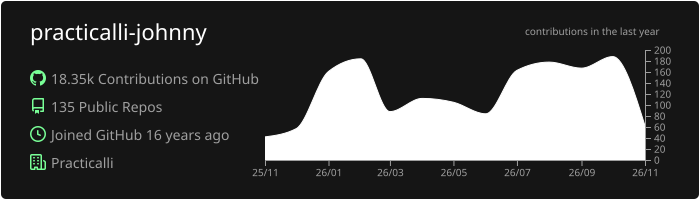
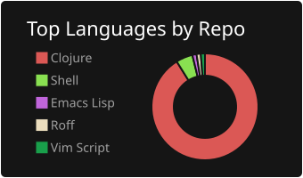
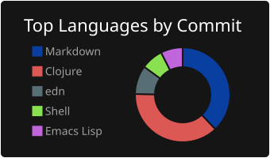
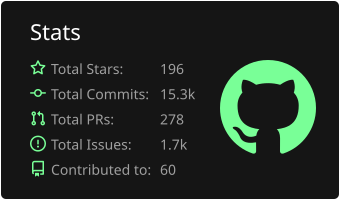
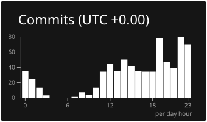

# Practicalli

[An engineer with a wide range of commercial & community experiences](https://www.linkedin.com/in/jr0cket/) across multiple industries and companies small & large.

My working experiencs have varied from large organisations (Citi, Salesforce) to early stage startups (Fintech, Data Science, Insurance, UK Government, Biopharmaceutical).  See my [LinkedIn profile for a full career history](https://www.linkedin.com/in/jr0cket/).

* **_Leadership_**: engineering management and technical founder roles, aligning technical strategy & delivery with business goals
* **_Technical team management_**: shape effective teams by evolving ways of working and thinking
* **_Engineering practices coach_**: adoption of agile and lean principles & practices to ingrain an effective process
* **_Consultancy_**: analysis, architecture, design & implementation embedded with customers
* **_Developer advocacy_ & _Community Management_** - enabling developers to use products, tools and languages effectively
* **_Product development_**: on a wide range of products and services across many industries
* **_Tech support team management_**: created effective support teams & capability, active on support duties
* **_Technical training_**: products, programming langugages, design principles, software development processes
* **_Tech writing_**: commercially for technical & non-tech audiences and Open Source projects, e.g. [Practical.li](https://practical.li/), [Atlassian](https://www.atlassian.com/), [Heroku](https://www.heroku.com/developers/), [Salesforce](https://developer.salesforce.com/), etc.

---

<!--
- UK Fintech: Engineering Manager for the platform team, building a bank with functional programming and immutable data
- Berlin Fintech startup: a Machine Learning Platform Architect, developing data transformation services as well as evolving organisational and engineering practices for engineers and data scientists.
-->

---

I am the founder of [Practicalli](https://practical.li) which provides community educational resources for software engineering, with a focus on Clojure and common development tooling.  The work is done in personal time and includes [freely available videos and books on Clojure and ClojureScript development](https://practical.li/), guiding those interested in building services with the powerful, elegant and fun Clojure language.

I have learned a great deal whilst investing time over the last decade to supporting people in the London developer community as well as many online communities.  I have had the pleasure of organising many hundreds of events for the [London Clojurians community](https://londonclojurians.org/).  I've also helped run 12 [ClojureBridge London](https://clojurebridgelondon.github.io/) events, supporting people from under-represented groups as they start their journey into the software industry.

In my spare time I love to cycle and in 2019 I cycled 1,000 miles (1,600km) across Britain in 9 days and raise thousands of pounds for charity.

## Sponsor Practicalli

All sponsorship funds are used to support the continued development of [Practicalli series of books and videos](https://practical.li/), although most work is done at personal cost and time.

Thanks to [Cognitect](https://www.cognitect.com/), [Nubank](https://nubank.com.br/) and a wide range of other [sponsors](https://github.com/sponsors/practicalli-johnny#sponsors) from the Clojure community for your continued support

---

## Recent articles
<!-- BLOG-POST-LIST:START -->
- [Use the latest Dev Tools on a Stable Debian Linux](https://practical.li/blog/2026/03/29/use-the-latest-dev-tools-on-a-stable-debian-linux/)
- [Advantages of writing documentation for code](https://practical.li/blog/2025/04/13/advantages-of-writing-documentation-for-code/)
- [Essential tooling for Clojure development](https://practical.li/blog/2024/01/29/essential-tooling-for-clojure-development/)
- [Safeguard against Git Commit Spoofing](https://practical.li/blog/2024/01/20/safeguard-against-git-commit-spoofing/)
- [Build Emacs from source on Debian Linux](https://practical.li/blog/2023/10/21/build-emacs-from-source-on-debian-linux/)
- [Expose Clojure Service using Ngrok](https://practical.li/blog/2023/08/24/expose-clojure-service-using-ngrok/)
- [Pin Emacs packages to manage issues](https://practical.li/blog/2023/08/15/pin-emacs-packages-to-manage-issues/)
<!-- BLOG-POST-LIST:END -->

---

## Personal Journal
<!-- PRACTICALLI_JOURNAL:START -->
- [Its cold outside](https://practical.li/journal/2026/11/09/its-cold-outside/)
- [Applying for Engineering Manager roles](https://practical.li/journal/2026/11/02/applying-for-engineering-manager-roles/)
- [Back to GMT time](https://practical.li/journal/2026/10/26/back-to-gmt-time/)
- [Working like a boss](https://practical.li/journal/2026/10/19/working-like-a-boss/)
<!-- PRACTICALLI_JOURNAL:END -->

---

## Activity Statistics

---

<!-- GitHub Profile Summary Cards from GitHub Workflow -->
<!-- https://github.com/vn7n24fzkq/github-profile-summary-cards -->

Practicalli-Johnny user account (via GitHub workflow):

 
 

Practicalli Org (Vercel app API):

---

## Discussions & Social Media

